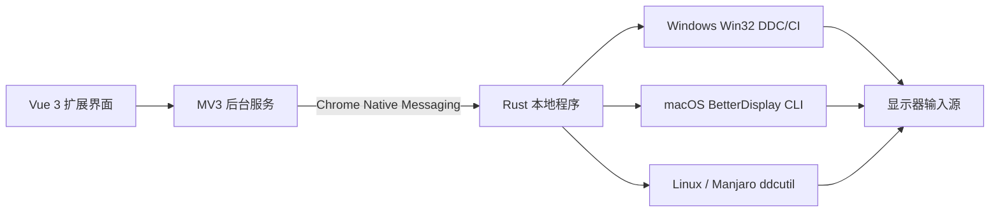

# 架构



每台电脑使用同一套扩展、各自系统编译的 Rust 程序和本地设置。没有常驻 HTTP 服务，不依赖局域网互通。Chrome 按需启动本地程序。对端电脑信息通过显式配对码交换，系统来自各自主机报告。

## 安装流程

MonoSwitch 使用嵌入式安装器：开发构建先编译 host，再通过 build.rs 嵌入 setup 安装器；产物校验操作系统/架构后写入扩展内置目录，附版本、扩展 ID、大小和 SHA-256。引导页根据 Chrome 平台信息选择匹配项，用户点击「下载组件」后通过 Downloads API 跟踪真实下载状态。页面重新打开时，从 Chrome 下载历史中恢复本扩展发起的当前安装包下载，不另存一份下载状态。下载 URL 携带安装包内容摘要，避免同名文件重新构建后误用旧下载；该参数用于区分下载记录，不代表浏览器执行了文件完整性校验。下载中断或文件已删除时可重试。

仅下载完成后显示「打开安装器」（Windows）或「解压安装包」（macOS），由用户点击调用 `chrome.downloads.open()`，并提供「在文件夹中显示」作为备用入口。扩展要求 Chrome / Chromium 123+。Linux 直接下载 ELF 程序为 `Install MonoSwitch.run`，不使用压缩包。Chrome 下载后无执行权限，界面提供文件属性授权指引和精确引用下载路径的 chmod + 启动命令。

Linux 安装器先运行只读检查，仅在缺少依赖、模块、开机加载或视频设备访问权限时请求系统授权。固定配置脚本通过 pkexec（图形环境）或 sudo（终端）执行：按发行版安装 ddcutil，加载 i2c-dev，写入 `/etc/modules-load.d/monoswitch-i2c.conf`，保留发行版 udev 规则并按需补充仅针对视频总线的 uaccess 规则，刷新设备权限。不会开放所有 I²C 设备的全局读写权限。包管理器参数固定，不会进行全系统升级。

系统配置失败或用户取消授权时，安装器仍安装用户组件并返回警告，扩展可稍后重试。系统准备完成后才注册新的本机组件；连接成功不等于显示器已就绪。`--skip-system` 跳过系统修改，`--isolated-dir` 始终禁止系统配置及提权。正常卸载只移除用户组件，不删除可能被其他软件共用的 ddcutil、内核模块或设备规则。

安装器使用版本化程序路径，更新注册时保留回滚数据。系统软件包与共享设备配置不属于用户组件事务，安装失败不会回滚这些系统准备步骤。没有常驻服务或应用自启动项；Linux 会按需配置 i2c-dev 开机加载。

## JSON 协议

TypeScript 合约位于 `shared/protocol.ts`。Native Messaging 使用本机字节序的 4 字节长度前缀及 UTF-8 JSON，stdout 仅承载协议。

```json
{"action":"status"}
```

返回平台、发行版、后端状态、显示器及输入源。Linux 还返回 `systemSetup`（需要修复的项目、是否可自动配置）。`status` 不提权、不修改系统。

`{"action":"repair"}` 只在用户点击「自动配置」且后台收到显式确认时发送，执行上述固定 Linux 配置并重新检测；不接收命令、路径或包名参数。后台用 Native Messaging 长连接保持配置过程，保存进度并阻止重复操作；关闭弹窗不会结束已启动的配置。

```json
{"action":"switch","displayId":"由status返回的ID","input":17}
```

`input` 是整数，范围 1–255；只能控制 VCP `0x60`。DDC 控制命令按参数数组启动，不经 shell 拼接。系统配置是编译进程序的固定 shell 脚本，发行版映射为预定义包管理器枚举，没有来自扩展的脚本输入。后台统一承接请求，避免界面关闭中断前端回调逻辑；硬件通信可能耗时，界面显示进行中状态并限制重复提交。

成功响应为 `{ "ok": true, "data": ... }`，错误响应为 `{ "ok": false, "error": { "code": "...", "message": "..." } }`。切换响应 `accepted` 只表示命令提交，不能验证对端视频输出。输入切换后原连接可能立刻不可读，因此不自动重试写命令。

## 输入源与显示器身份

优先使用显示器报告的输入枚举。无法获取时列出标准候选，并补入成功读取的当前输入，标记 `inputDetection: "standard"`。这些候选仍须由用户按接线显式配置，当前输入不会自动认定为本机接口。显示器 ID 属于当前系统，不能在两台电脑之间复用；配对信息只携带可核对的显示器名称/序列号、输入码和平台信息。

系统识别与硬件控制分离：浏览器界面可在没有本地程序时显示安装引导；演示模式必须显式使用 `?demo=1`，不调用真实硬件。配对码只解析白名单字段，不执行其中的内容。

## 参考接口

- [Chrome Native Messaging](https://developer.chrome.com/docs/extensions/develop/concepts/native-messaging)
- [Chrome Downloads API](https://developer.chrome.com/docs/extensions/reference/api/downloads)
- [Windows SetVCPFeature](https://learn.microsoft.com/en-us/windows/win32/api/lowlevelmonitorconfigurationapi/nf-lowlevelmonitorconfigurationapi-setvcpfeature)
- [ddcutil getvcp](https://www.ddcutil.com/command_getvcp/) 与 [setvcp](https://www.ddcutil.com/command_setvcp/)
- [BetterDisplay CLI](https://github.com/waydabber/BetterDisplay/wiki/Integration-features,-CLI)
